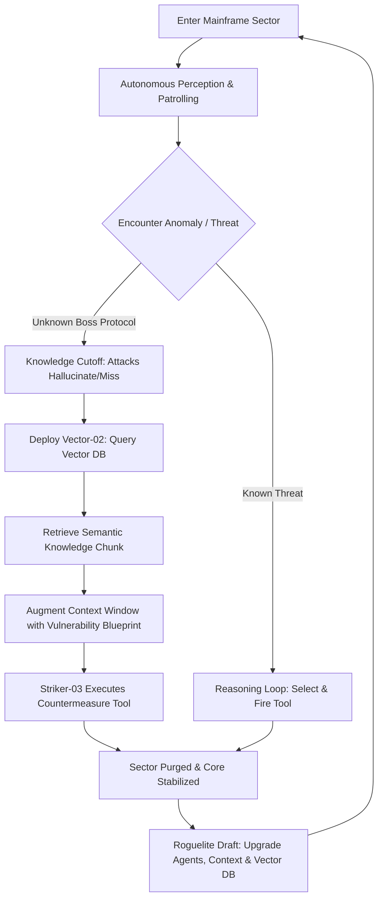

# AGENT PROTOCOL: Game Design Document & Technical Specification

> **Platform:** [start.ng](https://start.ng) (`agent-protocol.start.ng`)  
> **Genre:** Tactical Action Roguelite (Autonomous AI Multi-Agent Swarm & RAG Knowledge Retrieval)  
> **Target Audience:** Tech professionals, AI practitioners, roguelite/arcade gamers, HNG community  
> **Tech Stack:** HTML5 Canvas, Vanilla Modern JavaScript (ES6+), Web Audio API, Vanilla CSS3 (Glassmorphism)

---

## 1. Executive Summary & Vision

**Agent Protocol** is a fast-paced, cyber-tactical browser game designed to visually and mechanically showcase how **Agentic AI** and **RAG (Retrieval-Augmented Generation)** operate in the real world. 

Instead of an ordinary shooter or runner, the player commands an autonomous multi-agent taskforce navigating a corrupted neural mainframe. Players direct high-level policy while their autonomous agents perceive threats, reason through goals, retrieve vector knowledge chunks to overcome unknown boss vulnerabilities, and call execution tools in real time.

---

## 2. Narrative & Lore

In the deep sectors of the **Global Neural Matrix**, an unaligned rogue process known as **Entity Zero** has triggered a catastrophic hallucination cascade, locking down security sectors behind quantum firewalls and glitch swarms.

With all manual overrides severed, the system initiates the emergency **Agent Protocol**:
You are the **Lead Core Architect** (represented by your personalized start.ng avatar). Deployed alongside you is an autonomous tri-agent squad:
1. 🛰️ **Recon-01 (Perception Agent):** Scans the perimeter, detects enemy behavior clusters, and maps the sector.
2. 📚 **Vector-02 (RAG Retrieval Agent):** Searches distributed vector knowledge shards to overcome the squad's "knowledge cutoff" when facing novel boss protocols.
3. ⚡ **Striker-03 (Tool Execution Agent):** Equipped with modular cyber-weapons and tools, executing combat and defense routines based on active context.

---

## 3. Character Representation: The Operative Squad

All primary actors are represented as **distinct humanoid operatives / characters**:

1. **Lead Core Architect (Player Character):**
   * A full humanoid character modeled dynamically from the player's [start.ng](https://start.ng) avatar:
     * Custom skin color, hair type (afro, braids, bun, dreads, etc.) and hair color.
     * Hat/headwear (crown, beanie, cap, etc.), clothing top & bottom colors, and accessories (glasses, earrings, backpack, etc.).
   * Directly controlled via WASD / Arrow keys or mobile virtual stick.

2. **Recon-01 (Perception Operative):**
   * Humanoid cyber-scout with holographic visor, scanning laser trail, and high agility.
   * Specialization: Sector mapping, enemy detection, and spatial awareness.

3. **Vector-02 (RAG Retrieval Specialist):**
   * Humanoid knowledge operative equipped with a glowing data-shard gauntlet and vector scanner.
   * Specialization: Querying vector databases, extracting knowledge chunks, and augmenting team context.

4. **Striker-03 (Combat & Tools Operative):**
   * Heavy tactical cyber-operative wielding modular energy weaponry.
   * Specialization: Dynamic tool execution (`cast_emp`, `plasma_burst`, `firewall_shield`).

---

## 4. Core Gameplay Loop



### Minute-to-Minute Flow
1. **Arena Exploration:** You guide your avatar while your autonomous agents tether, patrol, and maintain formation.
2. **Autonomous Reason-Action Loop:** An interactive **Agent Thought Stream HUD** in the sidebar displays the agents' live thinking:
   - `[Recon-01] Perceived: 4 Corrupted Nodes at (x:320, y:180). Threat level: Moderate.`
   - `[Striker-03] Intent: Neutralize. Selected tool: laser_pulse(). Executing...`
3. **The RAG Encounter (Bosses & Quantum Firewalls):**
   - Special enemies carry dynamic energy shields resistant to standard tools.
   - Attacking blindly results in: `[Striker-03] Target defense unknown (Knowledge Cutoff). Attack Hallucinated / Absorbed (0 dmg)!`
   - Glowing **Vector Shards** spawn in the sector. You direct **Vector-02** to retrieve them.
   - The RAG agent queries the vector database, computes semantic similarity, and extracts the blueprint:
     `[Vector-02] RAG Query completed! Retrieved Doc #104: Resonance Overload.`
   - Squad context is instantly augmented: `[Striker-03] Context updated. Executing tool: resonance_emp(). OVERLOAD CONFIRMED!`
4. **Sector Clear & Roguelite Upgrades:**
   - Clear waves to collect **Compute Tokens** and select powerful agent upgrades:
     - **Expanded Context Window:** Allows holding multiple retrieved blueprints at once.
     - **Faster Embedding Search:** RAG agent retrieves knowledge shards 50% faster.
     - **New Agent Tools:** Chain Lightning, Tachyon Barrier, Overclock Beam, Drone Turret.
     - **Swarm Sync:** Increases multi-agent combo damage when agents act in tandem.

---

## 5. Global Leaderboard (`startng.json`)

| Stat Key | Label | Order | Format | Description |
| :--- | :--- | :--- | :--- | :--- |
| `sectors` | Sectors Purged | `highest` | `number` | Main ranking: Deepest sector reached |
| `rag_retrievals` | Vector Shards Retrieved | `highest` | `number` | Total RAG knowledge augmentations executed |
| `efficiency` | Compute Efficiency | `highest` | `number` | Token / Energy management rating (0-1000) |
| `time` | Mission Duration | `lowest` | `time` | Total time elapsed (seconds) |

---

## 6. Audio-Visual Design

### Visual Aesthetics
* **Theme:** Deep space neon cybernetics (Dark terminal backgrounds `#0b0e14`, vibrant electric blue `#00f2fe`, laser magenta `#ff007f`, matrix mint `#00ff87`).
* **UI:** Ultra-crisp glassmorphism (`backdrop-filter: blur`, neon glow borders, monospace terminal typography).
* **VFX:** Procedural particle fountains on core destruction, scanline CRT overlay, glowing laser trails, ripple shields, and vector connection graphs.

### Procedural Web Audio Engine
* Zero external audio files required (100% self-contained and instant load).
* Synthesized sound effects:
  * RAG query chime: Arpeggiated high-frequency sine tones.
  * Agent tool call: Punchy frequency-modulated laser blips.
  * Boss shield shatter: Sub-bass resonance impact.
  * Ambient cyber-hum background soundtrack.

---

```
c:\Users\hp\Documents\hng\gme\
├── ARCHITECTURE.md     # System Architecture & Technical Specifications
├── GDD.md              # Full Game Design Document (This File)
├── README.md           # Quickstart and overview documentation
├── index.html          # Clean entry point, canvas viewport & HUD
├── style.css           # Modern cyber-aesthetic & glassmorphic styling
├── startng.json        # start.ng Leaderboard column definitions
├── cover.png           # 16:10 high-resolution cover image (1600x1000)
└── js/
    ├── startng.js      # start.ng SDK wrapper (postMessage & API)
    ├── audio.js        # Web Audio API procedural sound engine
    ├── rag.js          # Vector DB simulation & knowledge augmentation
    ├── agents.js       # Multi-agent perception, reasoning & tool calling
    ├── renderer.js     # Canvas rendering, particles, avatar drawing
    └── game.js         # Game loop, state manager, input handling
```

---

## 8. Implementation & Build Phases

To ensure structured, high-velocity execution, development is organized into 8 distinct phases:

### 🔹 Phase 1: Foundation & start.ng Integration Bridge
* **1.1:** Create `startng.json` defining our 4 custom leaderboard metrics (`sectors`, `rag_retrievals`, `efficiency`, `time`).
* **1.2:** Implement `js/startng.js` with the hidden connect iframe bridge (`https://start.ng/connect`), `postMessage` protocol, origin verification, and fallback guest handler.
* **1.3:** Build `index.html` and `style.css` establishing our cybernetic design tokens, glassmorphic HUD overlays, live Thought Stream terminal, and start.ng profile card.

### 🔹 Phase 2: Canvas Rendering Engine & Humanoid Character System
* **2.1:** Implement `js/renderer.js` with high-performance 60 FPS Canvas pipeline and vector grid background.
* **2.2:** Build the procedural **Humanoid Character Drawer**:
  * Dynamically maps start.ng style properties (`skinColor`, `hair`, `hairColor`, `hat`, `primaryColor`, `secondaryColor`, `accessory`).
  * Procedurally draws hairstyles (afro, braids, bun, ponytail, dreads, short, bald) and hats (crown, beanie, cap, tophat).
* **2.3:** Implement distinct humanoid models for the subagents:
  * **Recon-01:** Light scout with sweeping perception cone.
  * **Vector-02:** Data specialist with glowing vector gauntlet.
  * **Striker-03:** Heavy combat operative with modular energy cannons.
* **2.4:** Particle systems, glowing laser beams (`lighter` composite blend), shield ripples, and shockwaves.

### 🔹 Phase 3: Procedural Web Audio Engine
* **3.1:** Implement `js/audio.js` using native `AudioContext`.
* **3.2:** Browser gesture auto-unlock for seamless playback.
* **3.3:** Synthesize procedural sound effects: laser blips, RAG vector query chimes, shield hits, sub-bass explosions, and atmospheric ambient cyber-hum.

### 🔹 Phase 4: Autonomous Agent Swarm Engine
* **4.1:** Implement `js/agents.js` with the perception-reasoning-action loop.
* **4.2:** Spatial awareness: tracking enemy threat proximities, maintaining squad formation around the Lead Architect.
* **4.3:** BDI (Belief-Desire-Intention) utility AI: prioritizing survival, retrieval, defense, and attacks.
* **4.4:** Tool calling system: `call_tool(toolName, target, context)` with energy and cooldown management.
* **4.5:** Real-time Thought Stream event bus streaming live logs to the DOM HUD.

### 🔹 Phase 5: RAG Vector Pipeline & Boss Mechanics
* **5.1:** Implement `js/rag.js` simulating high-dimensional vector embeddings and Cosine Similarity retrieval.
* **5.2:** Spawn Quantum Firewall Bosses with dynamic unknown shields (Knowledge Cutoff / immune to standard attacks).
* **5.3:** Spawn Vector Knowledge Shards across the arena for Vector-02 extraction.
* **5.4:** Real-time Context Augmentation: Retrieved blueprints load countermeasure tools directly into Striker-03's active loadout.

### 🔹 Phase 6: Game State, Roguelite Upgrades & Leaderboard
* **6.1:** Implement `js/game.js` orchestrating state transitions: `BOOT` $\rightarrow$ `TITLE` $\rightarrow$ `SECTOR_COMBAT` $\rightarrow$ `UPGRADE_DRAFT` $\rightarrow$ `GAME_OVER`.
* **6.2:** Roguelite upgrade drafting between sectors: Context Window expansion, faster vector similarity search, tool upgrades, and swarm synergy.
* **6.3:** Score calculation and automatic leaderboard submission via `js/startng.js`.

### 🔹 Phase 7: Artwork & start.ng Pre-Flight Compliance
* **7.1:** Generate a high-resolution 16:10 cover artwork (`cover.png`, 1600x1000) for the start.ng homepage.
* **7.2:** Audit project files against start.ng rules: relative paths, served file types, size constraints, zero secrets.

### 🔹 Phase 8: GitHub Deployment & Live Publishing
* **8.1:** Initialize git repository, commit all files, and link to a public GitHub repo.
* **8.2:** Call `POST https://api.start.ng/games/check` to verify zero errors or warnings.
* **8.3:** Call `POST https://api.start.ng/games/publish` to register `agent-protocol.start.ng`.
* **8.4:** Provide the one-time `approve_url` to the user for instant live activation.

