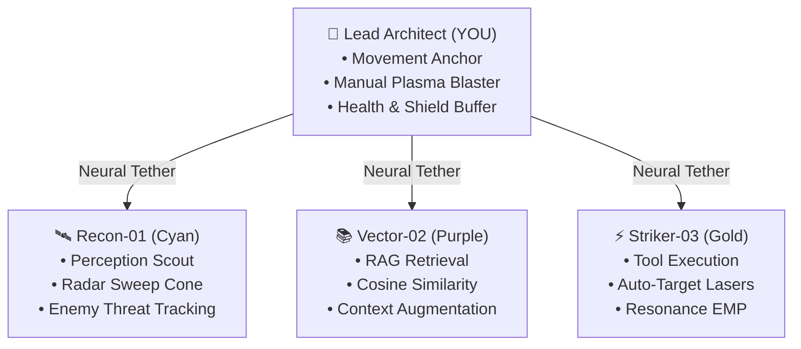
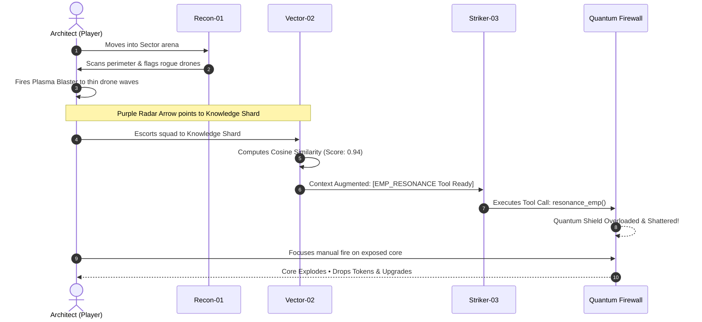

# 📖 AGENT PROTOCOL: Tactical Field Manual & Operative Guide

> **Target Platform:** [start.ng](https://agent-protocol.start.ng)  
> **Clearance Level:** Lead Core Architect  
> **Version:** 1.0.0 Production  

---

## 🎯 1. Mission Briefing & Premise

In **Agent Protocol**, you enter the role of the **Lead Core Architect** commanding an autonomous tri-agent cybernetic strike squad inside a corrupted neural network matrix. 

A rogue self-modifying system has encrypted the sectors behind impenetrable **Quantum Firewalls**. Standard kinetic attacks are immediately deflected by the firewall's unknown dynamic encryption frequency. 

To purge each sector, you must coordinate your squad's specialized **AI Agentic capabilities** and execute real-time **Retrieval-Augmented Generation (RAG)**:
1. Locate high-dimensional **Knowledge Shards** scattered across the sector.
2. Escort your RAG specialist (**Vector-02**) into proximity to calculate semantic cosine similarity embeddings.
3. Augment your swarm's **Context Window** with countermeasure blueprints.
4. Trigger your combat operative (**Striker-03**) to execute the retrieved countermeasure tool (`resonance_emp`), shattering the boss shield so the core can be destroyed.

---

## 👥 2. Squad Roster & Character Roles

All characters are rendered as humanoid operatives equipped with specialized cybernetic gear, directional aim lines, and glowing floor pedestals.



### 👤 YOU: The Lead Core Architect
* **Visual Appearance:** Custom-dressed using your [start.ng](https://start.ng) profile styling (custom hairstyle, hat, clothing colors, and skin tone). Displays a glowing cyan floor pedestal and `YOU [ARCHITECT]` overhead badge.
* **Role:** The tactical anchor. Where you walk, your squad follows via encrypted neural tethers.
* **Armament:** Directional High-Frequency Plasma Blaster.
* **Defenses:** 
  * **100 Shield:** Absorbs damage first. Regenerates automatically after 4 seconds of avoiding hits.
  * **100 Health:** Core structural integrity.
  * **Hit Invulnerability:** 0.65-second grace window after taking damage to prevent instant melting.

### 🛰️ Recon-01: Perception Scout (Cyan)
* **Visual Appearance:** Cyan combat jumpsuit with short cyber hair, glowing visor, and a wide forward radar detection cone.
* **Role:** Autonomous perception. Scans 360° of the sector to detect corrupted drone coordinates, calculates proximity threats, and streams tactical telemetry to the team.

### 📚 Vector-02: RAG Knowledge Retrieval (Purple)
* **Visual Appearance:** Purple cyber coat with braided locks and a pulsing semantic retrieval aura.
* **Role:** Semantic search specialist. When brought within range of a **Knowledge Shard**, Vector-02 extracts vector embeddings, runs cosine similarity matching, and injects actionable countermeasure blueprints into the swarm's active context window.

### ⚡ Striker-03: Tool Execution & Combat (Gold)
* **Visual Appearance:** Amber/gold heavy armor plate with an afro silhouette and handheld energy emitter.
* **Role:** Autonomous tool calling. Striker-03 independently locks onto nearby drones with laser pulses. Once Vector-02 augments the squad's context with a countermeasure tool, Striker-03 executes `resonance_emp` to shatter the boss's quantum firewall.

---

## 🎮 3. Controls & Combat Mechanics

| Action | PC / Keyboard & Mouse | Mobile / Touch Screen | Description |
| :--- | :--- | :--- | :--- |
| **Move Architect** | <kbd>W</kbd> <kbd>A</kbd> <kbd>S</kbd> <kbd>D</kbd> or <kbd>↑</kbd> <kbd>←</kbd> <kbd>↓</kbd> <kbd>→</kbd> | Virtual Joystick (Left) | Smooth directional movement. The 3 subagents follow in triangular formation. |
| **Aim Weapon** | **Mouse Cursor** | Screen Drag | Rotates your Architect's aiming line and weapon towards the target. |
| **Fire Plasma Blaster** | **Left Click** or <kbd>Spacebar</kbd> | Action Button (Right) | Rapid-fire plasma bolts (6.25 shots/sec) dealing 28 direct kinetic damage per shot. |
| **Toggle Thought Stream** | Click **Stream Toggle** in top header | Tap **Stream Header** | Expands or collapses the live AI reasoning terminal. |
| **Toggle Audio** | Click **Mute Button** in top header | Tap **Speaker Icon** | Mutes or unmutes procedural 8-bit/cyber Web Audio sound effects. |

---

## 🔄 4. Step-by-Step Mission Loop

Every sector follows a tactical loop that demands both manual marksmanship and agentic coordination:



### Phase 1: Perimeter Sweep & Drone Neutralization
* Corrupted **Combat Drones** (red rotating chassis with central menace eyes) converge from outside the screen.
* Watch the **Objective Banner** at the top: `Sector 01: Destroy Corrupted Drones (N Remaining)`.
* Defeated drones drop:
  * 🟡 **Compute Tokens:** +10 Tokens toward your efficiency score.
  * 🟢 **Nanite Repair Packs:** Restores +30 Health and +20 Shield.
  * *Tip:* Items have a vacuum magnet that pulls them into you when you walk near.

### Phase 2: RAG Vector Extraction
* Look for the **purple radar arrow** at the edge of your screen pointing toward the **Knowledge Shard** (a pulsing purple crystal).
* Walk your squad toward the shard. As **Vector-02** approaches, a purple extraction beam links to the crystal.
* In the **Thought Stream Terminal**, you will see Vector-02 log:
  ```text
  [VECTOR] Embedding query: "Firewall bypass protocol"...
  [VECTOR] Cosine similarity 0.942 against Knowledge Shard.
  [VECTOR] Retrieved tool countermeasure: [EMP_RESONANCE].
  ```

### Phase 3: Boss Shield Overload & Core Destruction
* Once the context slot is augmented, **Striker-03** automatically executes the tool call:
  ```text
  [STRIKER] Executing tool: resonance_emp(target: "firewall_boss").
  ```
* An expanding turquoise EMP shockwave emits across the screen. When it strikes the boss, its shield arcs shatter, turning its core green and vulnerable.
* The Objective Banner switches to:
  `⚡ FIREWALL VULNERABLE: Core exposed! All units open fire!`
* Unleash your plasma blaster and squad lasers onto the core until it detonates.

### Phase 4: Cognitive Upgrade Drafting
* Clearing a sector opens the **Roguelite Draft Terminal**.
* Choose 1 of 3 randomized perks to boost your swarm before entering the next sector:
  * **🧠 Context Window Expansion:** +2 active memory slots to hold multiple tool blueprints simultaneously.
  * **⚡ Embedding Accelerator:** +50% extraction speed and wider semantic retrieval radius for Vector-02.
  * **🔫 Overclocked Emitters:** +30% laser fire rate and increased projectile speed for Striker-03.
  * **🛰️ Perception Radar Boost:** +40% sensory cone range for Recon-01.

---

## 🖥️ 5. Reading the Cyber HUD

```
+----------------------------------------------------------------------------------+
| [🛡️ 100%] [❤️ 100%]  SECTOR: 01   COMPUTE: 240       [PLAYER @USER] [LEADERBOARD] |
+----------------------------------------------------------------------------------+
|               [🎯 OBJECTIVE: Destroy Corrupted Drones • Left Click to Shoot]      |
|                                                                                  |
|                                     [CANVAS]                                     |
|                  (Humanoids, Drones, Shards, Laser Projectiles)                  |
|                                                                                  |
|                                                      +---------------------------+|
|                                                      | LIVE AGENT COGNITION      ||
|                                                      | [RECON] Scanning grid...  ||
|                                                      | [VECTOR] Cosine: 0.94...  ||
|                                                      | [STRIKER] Laser pulse...  ||
|                                                      +---------------------------+|
+----------------------------------------------------------------------------------+
| [🛰️ RECON-01: PATROL]    [📚 VECTOR-02: EMBEDDING]    [⚡ STRIKER-03: FIRING]      |
+----------------------------------------------------------------------------------+
```

1. **Top Header:**
   * **Health & Shield Meter:** Green & Cyan status bars showing real-time defensive buffer.
   * **Sector Counter:** Current neural matrix tier.
   * **Compute Tokens:** Collected currency used to calculate end-game efficiency.
   * **start.ng Identity Card:** Displays your account avatar, username, and sign-in status.
2. **Mission Objective Banner (Top Center):**
   * Real-time guidance displaying current objectives, boss status, and recommended actions.
3. **Agent Thought Stream Terminal (Right Drawer):**
   * Real-time glassmorphic console logging the autonomous reasoning steps of Recon-01, Vector-02, and Striker-03.
4. **Squad Status Dock (Bottom Bar):**
   * Quick status indicators for each subagent (`SCANNING`, `QUERYING RAG`, `FIRING`).

---

## 🏆 6. Scoring & start.ng Global Leaderboard

When your health reaches 0, the protocol debrief screen calculates your run metrics and submits your score directly to the [start.ng](https://agent-protocol.start.ng) global leaderboard:

| Stat Key | Metric Name | Optimization Strategy |
| :--- | :--- | :--- |
| `sectors` | **Sectors Purged** | Clear as many sectors as possible by maintaining squad synergy and prioritizing boss firewalls. |
| `rag_retrievals` | **Vector Shards Retrieved** | Successfully retrieve knowledge shards with Vector-02 in every sector. |
| `efficiency` | **Compute Efficiency** | Maximize token collection while clearing sectors quickly without taking unnecessary damage. |
| `time` | **Mission Duration** | Shorter completion times yield higher leaderboard placement for speedruns. |

> [!TIP]
> **Leaderboard Persistence:** Playing while signed in to your [start.ng](https://start.ng) account automatically binds your high scores to your verified profile and ranks you against other players worldwide. If playing as a guest, your scores are recorded locally until you sign in.
